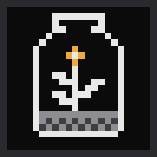
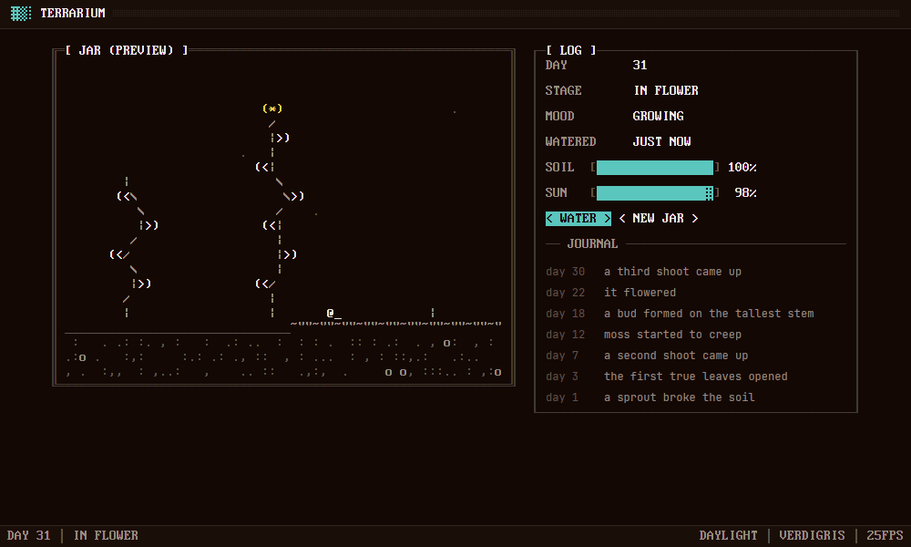

<p align="center">
  
</p>

<h1 align="center">Terrarium</h1>

<p align="center">
  A <a href="https://github.com/rwetz/ferrite-design">Ferrite</a> garden in a jar, drawn in text:
  it grows over real days, whether or not you're watching.
</p>

<p align="center">
  <a href="https://github.com/rwetz/ferrite-terrarium/actions/workflows/ci.yml"></a>
  <a href="https://github.com/rwetz/ferrite-terrarium/releases/latest"></a>
  <a href="LICENSE"></a>
</p>



Terrarium is a slow simulation you check on. A jar of soil gets a seed the
first time you open it. Over the following days, in daylight by your own
clock and as long as the soil is damp, it sprouts, puts out leaves, sends up
more shoots, buds, flowers, and slowly fills with moss. A snail crawls along
the soil by day and sleeps by night. Leave it dry and it wilts and waits;
water it and it perks up. Nothing dies, and there's nothing to optimise.

The jar's life isn't stored; it's replayed hour by hour from the day it was
planted and the times it was watered, so closing the app changes nothing.
The jar carries on without you.

It's a native desktop app built with [GPUI](https://gpui.rs) and
[ferrite-design](https://github.com/rwetz/ferrite-design): amber on iron,
0px corners, pixel type and stepped motion. It runs no webview.

## Features

- **The jar.** Stems, leaves, a flower, moss, stones and a snail in text
  mode, drawn from the jar's own seed, so every jar is different.
- **Real time.** Growth happens in daylight (roughly 6:00 to 20:00 on your
  clock) on damp soil. Soil dries over a few days: water it with
  <kbd>W</kbd>. It won't take water while the soil is still damp.
- **A journal.** The day of each first: the sprout, the first leaves, the
  second shoot, the moss, the bud, the flower. Wilting goes in too.
- **The log.** The jar's day, stage and mood, when it was last watered, and
  soil and sun gauges.
- **Ferrite throughout.** Ten color schemes (it starts in Verdigris), a
  command palette (<kbd>Ctrl</kbd>+<kbd>Shift</kbd>+<kbd>P</kbd>), stepped
  25 fps motion, and a CRT switch-off when you close the window.

## Install

### Download

Prebuilt binaries for Windows, macOS and Linux are attached to each
[release](https://github.com/rwetz/ferrite-terrarium/releases/latest).
Unpack the archive and run `ferrite-terrarium`. Nothing else is needed.

### From source

```bash
git clone https://github.com/rwetz/ferrite-terrarium
cd ferrite-terrarium
cargo run --release
```

On Linux you need the usual GPUI development packages first:

```bash
sudo apt install libxkbcommon-dev libxkbcommon-x11-dev libwayland-dev libxcb1-dev libfontconfig-dev
```

On macOS with Xcode 27 or later, install the Metal toolchain once:

```bash
xcodebuild -downloadComponent MetalToolchain
```

## Configuration

Open Settings with the title-bar button or **Ctrl+,** to change scheme, appearance, or FPS.

The look and the jar are saved as plain `key = value` lines:

| OS | Settings |
|---|---|
| Windows | `%APPDATA%\ferrite\terrarium.conf` |
| macOS | `~/Library/Application Support/ferrite/terrarium.conf` |
| Linux | `$XDG_CONFIG_HOME/ferrite/terrarium.conf` (or `~/.config/…`) |

```ini
scheme = verdigris    # ferrite mono graphite slate concrete harbor cyanotype phosphor verdigris bruise
appearance = dark     # dark | light | system
fps = 25              # 12–240

# The jar. Its life is replayed from these.
seed = 1791234567890
planted = 1791234567  # unix seconds
watered = 1791234567  # one line per watering
```

| Flag / variable | Effect |
|---|---|
| `--days N` | Shows a preview jar planted N days ago and watered every three days. Nothing is saved. |
| `FERRITE_*` | The shared look from [Lodestone](https://github.com/rwetz/ferrite-lodestone); provides defaults until the app saves its own preferences. |

## With Lodestone

[Lodestone](https://github.com/rwetz/ferrite-lodestone) launches Ferrite apps
from their **source checkouts**: it scans a folder for crates that depend on
ferrite-design, runs `cargo build`, and starts the result with its shared
look. To see Terrarium there, clone this repo next to Lodestone (or into the
folder you point Lodestone at) and have a Rust toolchain on your `PATH`:

```
Dev/
├── ferrite-lodestone/
└── ferrite-terrarium/ # appears as a tile in Lodestone
```

A downloaded Terrarium binary runs fine on its own, but Lodestone doesn't
discover installed binaries.

## Development

```bash
cargo test                    # growth, wilting, watering, drawing, settings
cargo clippy --all-targets
cargo run -- --days 30        # see a month-old jar
```

- `src/sim.rs`: the simulation (moisture, daylight, growth, the journal) and
  the drawing of the jar. Pure and deterministic, and unit-tested.
- `src/settings.rs`: the settings file and the jar.
- `src/main.rs`: the view. It follows ferrite-design's
  [AGENTS.md](https://github.com/rwetz/ferrite-design/blob/main/AGENTS.md).

On Windows, `build.rs` embeds `assets/logo.ico` as the executable and window
icon. The `.ico` is generated from `assets/logo.svg`, so regenerate it when
the logo changes.

## License

Apache-2.0, see [LICENSE](LICENSE). The binary embeds fonts from
ferrite-design under their own licenses; see [NOTICE](NOTICE).
